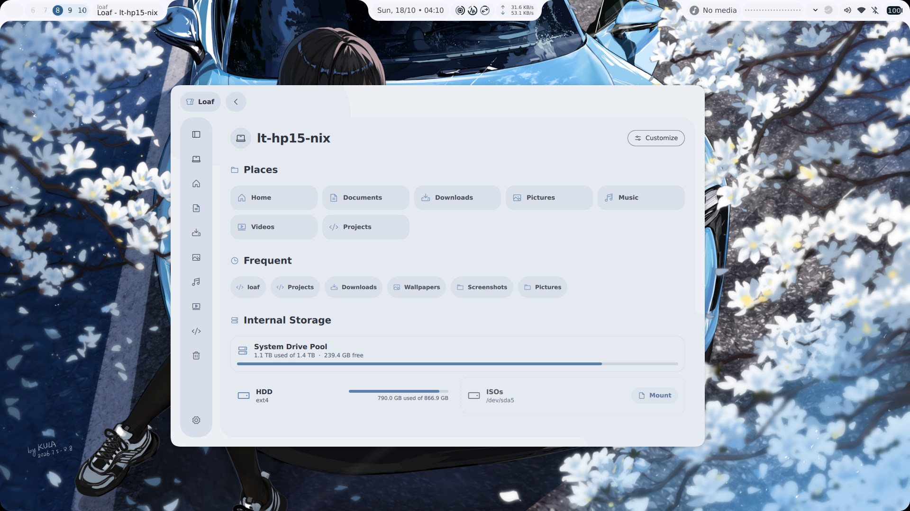

<div align="center">

# 🍞 Loaf

**A beautiful and fast Rust-based Material 3 Expressive file manager for Linux.**



<br/>

[](https://www.rust-lang.org/)
[](https://m3.material.io/)
[](https://phosphoricons.com/)
[](#installation)
[](LICENSE)

<br/>

</div>

---

## Overview

Loaf is designed to replace crowded, outdated file managers with an interface that looks modern, runs fast, and doesn't compromise on functionality. Built using **Rust** for native system performance and **Qt6 Quick / QML** for fluid Material 3 Expressive animations.
> Note: Loaf is still at a very alpha stage, expect bugs or missing features. Contributions of any kind are very welcome!
> Another Note: I'm kinda in need for an app icon for Loaf, if you're willing to help please DM me on discord; @m_uvex . Thank you!

---

## Features

- **Material 3 Expressive Design**: Fluid spring motion, smooth path transitions, and calibrated state layers.
- **Dynamic Theming**: 8 curated color palettes plus automatic dynamic palette generation from your desktop wallpaper.
- **Fast Directory Navigation**: Snappy directory switching with zero disk bottlenecks and smooth directional animations.
- **Archive Support**: One-click non-modal archive compression for `.zip`, password-protected encrypted `.zip`, `.tar.gz`, `.7z`, and advanced formats (`.tar.xz`, `.tar.zst`, `.tar.bz2`, `.cpio`).
- **Comprehensive Undo / Redo**: Multi-step operation history (`Ctrl+Z` / `Ctrl+Y`) for renames, creations, moves, and deletions.
- **Storage & Drive Dashboard**: "This PC" overview with internal drive pool stats, drive space indicators, mount/unmount/rename actions, and optional customizable layout.
- **Native Trash Integration**: Standard freedesktop directory listing of trashed items with one-click restore and toolbar empty action.
- **Multiple View Modes**: Responsive Grid View and Detailed List View with dynamic column adaptation for narrow windows.
- **Rich Drag & Drop**: Drag files into breadcrumb chips, folders, or path bar with right-click menu options (Copy, Move, Link Here).
- **Open With…**: Right-click any file or folder to pick the application that opens it (MIME-aware suggestions, a persisted Recent list, scrollable full app list, "Run Custom Command…" for any shell command, and a one-click "Set Default Application").
- **Quick Look**: Press `Space` (or use the context menu) for an inline preview — full-size images, rendered markdown, and syntax-highlighted source code, without launching an external app.
- **Navigation Controls**: Mouse side buttons (Back / Forward), full keyboard navigation, and click-outside search defocusing.

---

## Installation

Pre-built packages for **v0.1.0** are available in the [Releases](https://github.com/m-uvex/loaf-fm/releases) tab and under `packaging/dist/`.

### 1. Debian / Ubuntu / Linux Mint / Pop!_OS (`.deb`)

Download the `.deb` package and install it using `apt` or `dpkg`:

```bash
# Using apt (automatically resolves dependencies):
sudo apt install ./loaf_0.1.0_amd64.deb

# Or using dpkg:
sudo dpkg -i ./loaf_0.1.0_amd64.deb
sudo apt-get install -f
```

### 2. Arch Linux / Manjaro / EndeavourOS (`.pkg.tar.zst`)

Install the binary package with `pacman`:

```bash
sudo pacman -U ./loaf-0.1.0-1-x86_64.pkg.tar.zst
```

Or build from the included `PKGBUILD`:

```bash
makepkg -si
```

### 3. Universal Portable Tarball (Any Linux Distribution)

The standalone tarball contains the stripped binary, desktop integration, icons, and automated installer scripts:

```bash
# Extract the archive:
tar -xzf loaf-v0.1.0-linux-x86_64.tar.gz
cd loaf-0.1.0

# Install for current user (into ~/.local/bin and ~/.local/share):
./install.sh

# Or install system-wide for all users:
sudo ./install.sh --system
```

To run directly without installing:

```bash
./bin/loaf-run
```

To uninstall:

```bash
./uninstall.sh
```

### 4. Standalone AppImage (Universal)

The self-contained single-file executable runs out of the box with zero dependencies:

```bash
chmod +x Loaf-v0.1.0-x86_64.AppImage
./Loaf-v0.1.0-x86_64.AppImage
```

Or extract the AppDir bundle:

```bash
tar -xzf loaf-v0.1.0-AppDir.tar.gz
./Loaf.AppDir/AppRun
```

### 5. Using Nix / NixOS

Run directly with flakes enabled:

```bash
nix run github:m-uvex/loaf-fm
```

Or install to your user profile:

```bash
nix profile install github:m-uvex/loaf-fm
```

In a local clone:

```bash
nix run .#
```

---

## Building from Source

### Using Nix (Recommended)

Loaf provides a complete Nix flake containing all Qt6 libraries and build dependencies:

```bash
# Enter dev shell and run:
nix develop --command cargo run

# Compile an optimized release binary:
nix develop --command cargo build --release
```

### Manual Build

Requirements:
- Rust toolchain (1.75+)
- Qt 6.x (`qtbase`, `qtdeclarative`, `qtsvg`, `qtwayland`)
- CMake, Ninja, and `pkg-config`
- `p7zip` and `zip` (for archive handling)

```bash
cargo build --release
./target/release/loaf
```

---

## Keyboard Shortcuts

| Shortcut | Action |
| :--- | :--- |
| `Ctrl` + `Z` | Undo last operation |
| `Ctrl` + `Y` / `Ctrl` + `Shift` + `Z` | Redo last operation |
| `Ctrl` + `H` | Toggle hidden files |
| `Ctrl` + `L` | Edit path bar directly |
| `Alt` + `Left` / `Mouse Back` | Navigate back in history |
| `Alt` + `Right` / `Mouse Forward` | Navigate forward in history |
| `Alt` + `Up` / `Backspace` | Navigate to parent directory |
| `F2` | Rename selected item |
| `Space` | Quick Look preview (images, text, markdown, syntax-highlighted code) |
| `Delete` | Move selected items to Trash |
| `Ctrl` + `A` | Select all items |
| `Ctrl` + `C` / `Ctrl` + `X` / `Ctrl` + `V` | Copy / Cut / Paste |
| `Arrow Keys` | Move selection across files and folders |
| `Enter` / `Return` | Open selected item |
| `Escape` | Dismiss modal / Close context menu / Defocus search |

---

## Architecture

```text
loaf/
├── src/
│   ├── main.rs              Application entry point, QML engine, and event filters
│   └── bridge.rs            cxx-qt Rust engine, disk metrics, operations, undo/redo
├── qml/
│   ├── main.qml             Main window frame, navigation rail, and file stage
│   ├── PCView.qml           This PC tab: storage devices and frequent folders
│   ├── SettingsView.qml     Theme preferences, icons, behavior, and experimental toggles
│   ├── Theme.qml            Material 3 design token engine & palette derivation
│   ├── LoafIcon.qml         Vector icon resolver for Phosphor typography
│   └── components/          Reusable Material 3 component library
│       ├── LoafPopup.qml        Elevated popup container with smooth transitions
│       ├── LoafMenu.qml         Cascading menus and keyboard navigation
│       ├── LoafMenuItem.qml     Individual menu rows with sequential stagger animation
│       ├── LoafButton.qml       Tonal, filled, outlined, and text button variants
│       ├── LoafSwitch.qml       Spring-animated Material 3 pill toggle switch
│       ├── LoafSegmented.qml    Sliding segmented controls for view/sorting modes
│       ├── LoafDialog.qml       Centered modal dialog surfaces
│       ├── LoafTextPrompt.qml   Input modals (New Folder, New File, Rename, Password)
│       ├── LoafCard.qml         Interactive and surface card containers
│       ├── SectionHeader.qml    Unified dashboard and section headers
│       ├── UsageBar.qml         Smooth progress/storage capacity bar
│       └── DriveCard.qml        Mountable, partitioned, and external drive cards
├── packaging/               Packaging recipes, .desktop entries, icons, and dist artifacts
├── assets/
│   ├── fonts/               Phosphor font weights (Regular, Bold, Fill, Duotone, Light, Thin)
│   └── resources.qrc        Qt resource manifest
├── Cargo.toml               Rust package manifest
└── flake.nix                Nix flake declaring devShell and default package
```

---

## License

This project is licensed under the MIT License.
